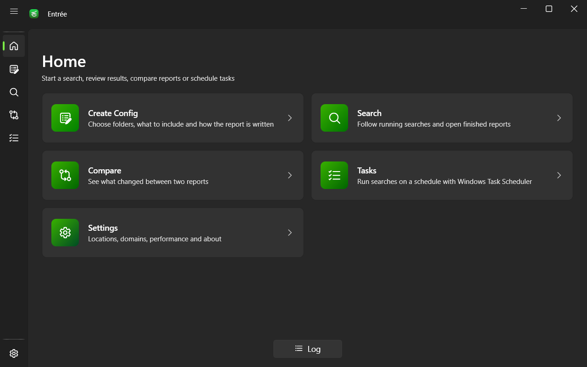
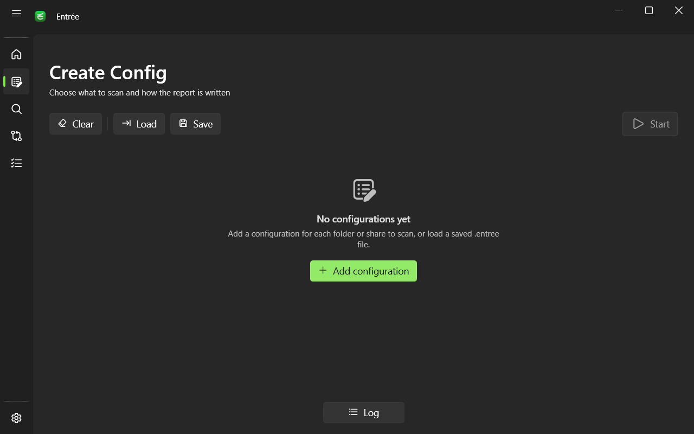
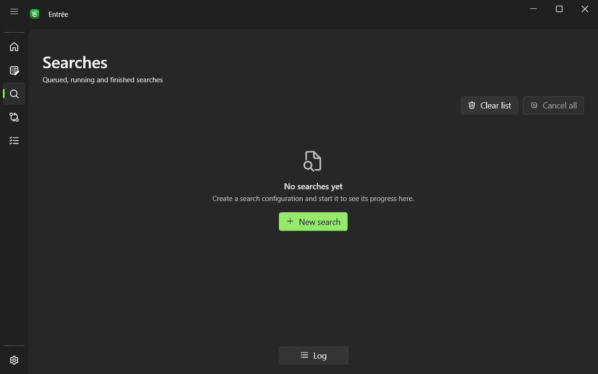
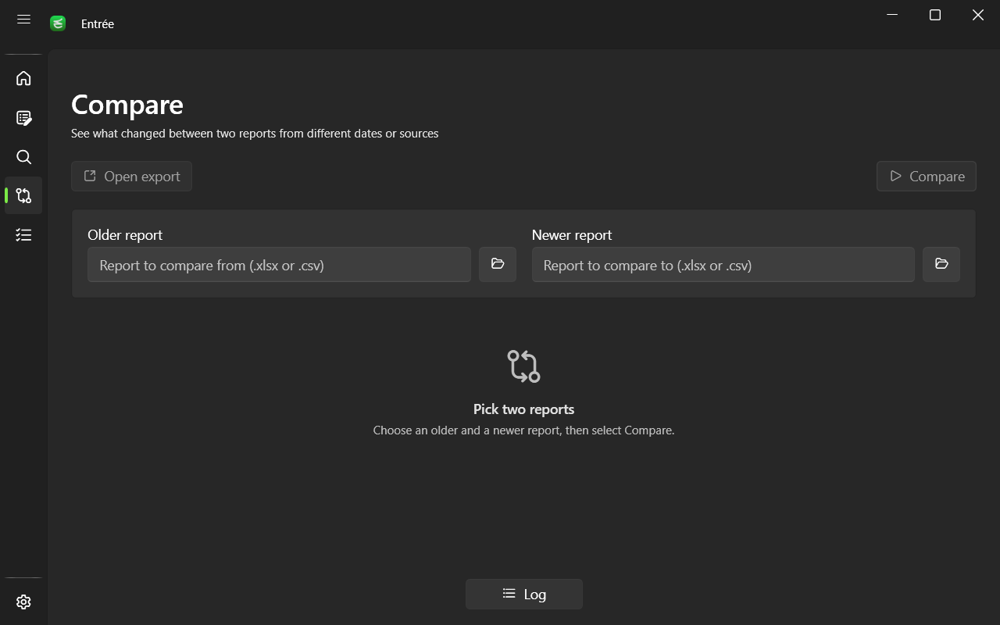

<div align="center">


# Entrée

**See who has access to what, and what changed.**

NTFS and SMB permission reports for Windows, compared over time and run on a schedule.

[](https://github.com/iBazs/Entree/releases)
[](LICENSE)
[](https://dotnet.microsoft.com/download/dotnet/8.0)
[](#install)

[Search](#search) · [Reports](#reports) · [Compare](#compare) · [Tasks](#tasks) · [Command line](#command-line) · [Install](#install)



</div>

## Highlights

- **Every share, one run.** Queue many folders and UNC shares, each with its own options, saved as one `.entree` file.
- **Built for big trees.** Parallel folder reads, long path support and cached security descriptors. Reports split cleanly past Excel limits.
- **Readable answers.** An access matrix shows only folders whose access differs from their parent. Nested groups are expanded to people.
- **Change tracking.** Compare two reports and get a list of new, missing and changed paths, accounts, rights, owners and dates.
- **Hands off.** Schedule searches in Windows Task Scheduler. They run silently from the tray.
- **Local and private.** No cloud and no telemetry. Domain passwords are encrypted with Windows DPAPI.

<table>
  <tr>
    <td width="33%"><p align="center"><b>Create Config</b></p></td>
    <td width="33%"><p align="center"><b>Search</b></p></td>
    <td width="33%"><p align="center"><b>Compare</b></p></td>
  </tr>
</table>

## Search

Add one configuration per folder or share. Duplicate, load, save, or drag a `.entree` file onto the page.

| Option | Choices | Default |
|---|---|---|
| Search path | Local folder, drive or `\\server\share` | |
| Search for | Files, Files and Directories, Directories | Files |
| Depth | All subfolders, Top folder only, N levels | All subfolders |
| Include inherited permissions | Off lists explicit entries only | On |
| Include owners | Adds an Owner column | On |
| Local domain only | Skip the extra domains from Settings | Off |
| Format | Excel `.xlsx` or CSV (zipped) | Excel |
| Group members | Adds the Groups sheet | On |
| Access matrix | Adds the Matrix sheet, with accounts to leave out | On |
| Open report when finished | | On |

While it runs you see the phase, current folder, item count and elapsed time, and you can cancel one search or all of them. Close the window mid run and Entrée finishes from the tray.

<details>
<summary><b>What Entrée handles for you</b></summary>

- Long paths and UNC paths, read through `\\?\` prefixes.
- Symlinks and junctions are listed but not followed.
- Unreadable folders stay in the report with the Windows error in an Error column.
- Accounts are resolved against the local machine and every domain added in Settings. Unreachable domains are skipped after a short timeout.
- Samba and NFS identities are labelled as `Unix User / uid N`, `Unix Group / gid N`, `NFS User`, `NFS Group` and NFS mode (`rwx`).
- Identical searches already in the queue share one result.
- Reports are named `<folder>_yyyy-MM-dd` and never overwrite an existing file.

</details>

## Reports

| Sheet | Contents |
|---|---|
| **RawData** | Path, Attributes, Owner, Identity, Account Rights, Access Type (Allow or Deny), Last Modified Date, Error |
| **Matrix** | Paths by accounts, one letter per cell, only where access differs from the parent folder |
| **Groups** | One column per group with its members, nested groups expanded |
| **Identity** | Full Name, Name, Domain, SID, Type, Enabled or Disabled, Error |

Matrix legend: **F** Full Control · **M** Modify · **W** Write · **R** Read · **L** List · **S** Special · **D** Deny · **?** Unknown. Deny overrides Allow for the same account.

<details>
<summary><b>Report details</b></summary>

- Headers are frozen and filtered. Disabled accounts are grey, unresolved accounts lime, and accounts found in several domains orange.
- Sheets split every 1,000,000 rows (`RawData_2`, ...). The matrix also splits every 10,000 accounts and Groups every 16,384 columns. Rows of one item are never split.
- CSV exports are a `.zip` holding `RawData.csv`, `Matrix.csv`, `Groups.csv` and `Identity.csv`.
- CSV cells that start with `=`, `+`, `-` or `@` are escaped, so a file name cannot run as a spreadsheet formula.

</details>

## Compare

Pick an older and a newer report (`.xlsx`, a CSV export `.zip`, or its `RawData.csv`) and export the result as Excel or CSV. The preview shows the first 100 changed paths.

| Difference | Meaning |
|---|---|
| New | Path exists only in the newer report |
| Missing | Path exists only in the older report |
| New Identity | An account gained an entry |
| Removed Identity | An account lost its entry |
| New Access | Rights for an account changed |
| New Owner | Owner changed |
| New Attributes | File attributes changed |
| Date Changed | Last modified date changed |

The export lists old and new values side by side, with columns only for the kinds of change found.

## Tasks

Schedule any saved `.entree` file. Tasks live in an `Entrée` folder in Windows Task Scheduler and run `Entree.exe --silent --search` from the tray.

- **Repeats:** once, every N days, every N weeks on chosen weekdays, or monthly on chosen days or a weekday (first to last) in chosen months.
- **Same time in every time zone:** stores recurring schedules in UTC.
- **Run with highest privileges** for shares that need an elevated token.
- Run now, stop, edit and delete from the task card.

## Command line

```bash
Entree.exe config.entree
Entree.exe --search config.entree
Entree.exe --silent --search config.entree
Entree.exe --compare older.xlsx newer.xlsx --xlsx
```

Opens a config, runs it with or without a window, or compares two reports (CSV output unless `--xlsx`). Switches accept `-`, `--` or `/`. Exit codes: `0` success, `1` failure, `2` usage.

<details>
<summary><b>Settings</b></summary>

- **Theme:** System, Light or Dark.
- **Locations:** log folder and default report folder.
- **Domains:** add domains by DNS name or IP, with an optional user name and password. Test the connection before saving.
- **Performance:** parallel threads, from 2 up to twice the CPU count.
- **About:** version, source code, license and third party libraries.

A log panel at the bottom keeps the last 1,000 entries, flags warnings and errors, and copies lines on right click.

</details>

## Install

Download a zip from [Releases](https://github.com/iBazs/Entree/releases), unzip, run `Entree.exe`.

| Build | Use when |
|---|---|
| `win-x64-self-contained` | Any PC, nothing to install |
| `win-x64-framework-dependent` | Smaller, needs the [.NET 8 Desktop Runtime](https://dotnet.microsoft.com/download/dotnet/8.0) |
| `win-arm64-*` | Windows on ARM |

## Build

```bash
dotnet test Entree.sln
dotnet run --project Entree
```

## License

[GPL-3.0-or-later](LICENSE)
